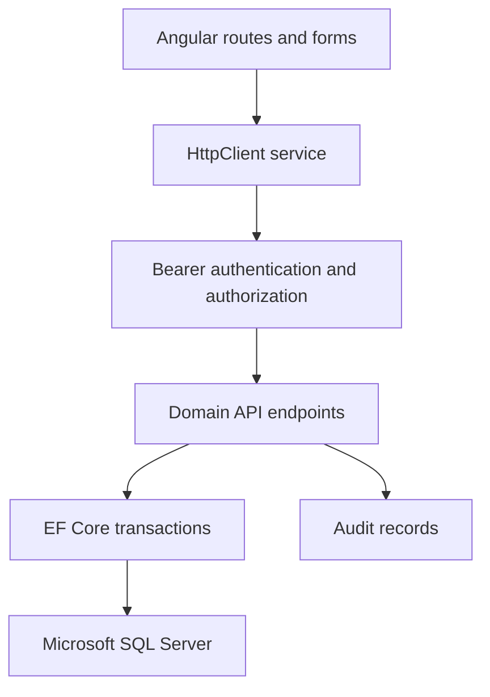
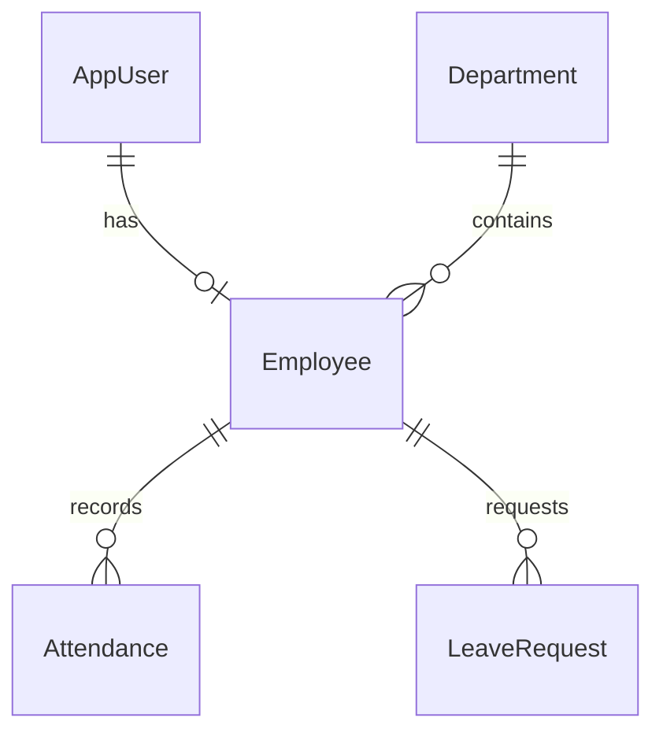

# Architecture and rules

`frontend/src/app/config.ts` defines each screen's columns, form fields, and UI permissions. `workspace.component.ts` implements form submission, workflow actions, filtering, CSV export, and navigation. `api.service.ts` attaches the in-memory bearer token.

`backend/Common.cs` contains authentication, account provisioning, error handling, audit support, version-based concurrency, and transaction helpers. `Models.cs` contains the domain entities, request DTOs, and EF relationship configuration. `Domain.cs` contains endpoints, business rules, and development data seeding. `Migrations/` is the committed SQL Server schema history. The test harness is a separate executable and does not change the application's SQL Server provider.

## Data relationships

## Business rules

- Leave counts Monday–Friday only; public holidays, half-days, carryover, and payroll are outside this version.
- A leave request must be in the future, on/after employment start, within one calendar year, and no later than the next calendar year.
- Pending and approved date ranges cannot overlap. Approval checks the remaining annual balance inside a serializable transaction.
- Cancellation of pending/approved leave before its start restores the balance because balances are calculated from approved requests.
- Approval is admin-only; repeat decisions and stale versions return 409.
- Attendance uses UTC day boundaries. One check-in per day; an earlier open session must be checked out before a new one.
- Employee historical records are retained; deactivate accounts instead of deleting employees.

## Authentication behavior

Passwords are hashed with ASP.NET Core PasswordHasher. Login is rate-limited by IP. Tokens expire after one hour and are kept only in browser memory; refreshing the page requires sign-in again. Sign out clears the local token. Existing issued tokens are not individually revoked by logout, but deactivating an account blocks its tokens on subsequent requests. API calls recheck account activity and role. There is no public registration; admins provision accounts. Password reset, MFA, and token refresh are not implemented.

## Concurrency

Mutable entities carry a numeric concurrency version incremented on updates. Update/action requests compare the client version and EF adds a version predicate when saving. Critical balance, inventory, and booking operations use short serializable transactions. SQL Server deadlocks and concurrency conflicts return 409 for the client to refresh/retry; there is no automatic replay of mutations. Unique indexes and restrictive foreign keys protect identity and referenced history. SQL Server locking behavior must be verified using the supplied SQL-backed CI workflow or a local SQL instance.
