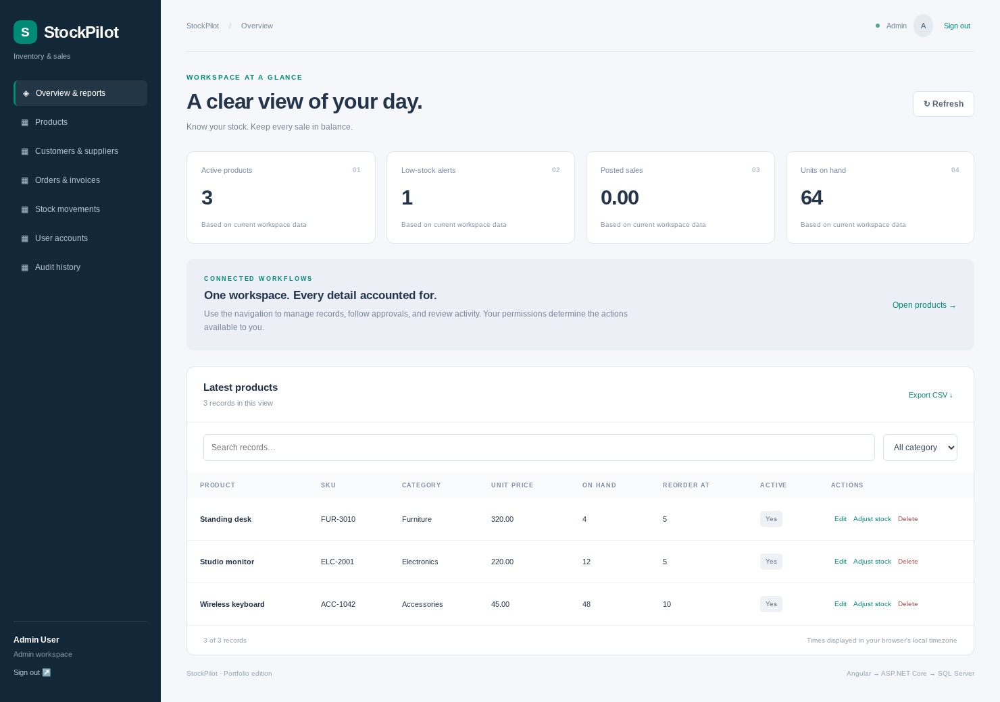

# StockPilot

Angular and C# inventory system with SQL Server, purchase/sales orders, transactional stock posting, movement history, and printable invoices.



## Implemented features

- Admin and staff access, product management, categories, and account administration.
- Customer and supplier records, with order references protected from accidental deletion.
- Multi-line purchase and sales orders with draft editing.
- Transactional order posting, stock validation, and immutable posted order lines.
- Stock adjustment reasons, movement ledger, low-stock counts, and printable sales invoices.
- Dashboard totals, CSV exports, and audit history.

## Technology

Angular 20.3, TypeScript, C# / ASP.NET Core 10, EF Core 10, and **Microsoft SQL Server**. Four independent repositories are provided; this one is `stockpilot`. It is a functional portfolio application with the rules documented in [Architecture](docs/ARCHITECTURE.md), not a claim of production certification.

## Prerequisites

- .NET 10 SDK.
- Node.js 24 LTS and npm.
- SQL Server 2022 or later, SQL Server Express, or SQL Server LocalDB on Windows.
- Optional: Visual Studio 2026, VS Code, SSMS, Python 3 for API tests.

## Run on Windows with LocalDB

The default development connection uses `(localdb)\MSSQLLocalDB` and database `StockPilot`. From this repository folder, open PowerShell:

```powershell
$env:ASPNETCORE_ENVIRONMENT = "Development"
dotnet run --project backend --urls http://localhost:5080
```

Development startup applies the included EF migrations and seeds fictional demo data if the user table is empty. Keep this terminal open.

In a second terminal:

```powershell
cd frontend
npm ci
npm start
```

Open http://localhost:4200. The Angular development proxy forwards `/api` to port 5080. Run one project at a time with these default ports, or change both the backend URL and `frontend/proxy.conf.json`.

## Use your SQL Server / SQL Express instance

Before starting the backend, override the connection in the same PowerShell session:

```powershell
$env:ConnectionStrings__Default = "Server=.\SQLEXPRESS;Database=StockPilot;Trusted_Connection=True;TrustServerCertificate=True;"
$env:ASPNETCORE_ENVIRONMENT = "Development"
dotnet run --project backend --urls http://localhost:5080
```

For SQL authentication, use your own server, username, and password. Do not commit real credentials. On Linux, use `export ASPNETCORE_ENVIRONMENT=Development` and `export ConnectionStrings__Default='Server=localhost,1433;Database=StockPilot;User ID=YOUR_USER;Password=YOUR_PASSWORD;Encrypt=True;TrustServerCertificate=True;'` before starting the API. `TrustServerCertificate=True` is a local-development setting; configure a trusted certificate for deployment.

## Demo accounts

| Role | Email |
| --- | --- |
| Admin | `admin@example.com` |
| Staff | `staff@example.com` |

Development demo password: **`PortfolioDemo!2026`**. This is fictional sample data. Set `Seed__Password` before the first development startup if you want a different seed password. Seeding is disabled outside Development/Testing. Changing this setting later does not reset existing accounts.

Create employee/resident accounts from Employees/Residents so their required profile relationships are created. Use User accounts for the other supported roles. No secrets or company data are included.

## Try the main workflow

1. Sign in as admin@example.com. Create a product and add opening stock with Adjust stock.
2. Create a Customer and Supplier in Customers & suppliers.
3. Create a sale with one or more product lines, then Post order. Confirm stock decreased.
4. Open Details on the posted sale to print/save the invoice. Try posting again through the API; it returns 409.

## Database migrations

From the repository root:

```powershell
dotnet tool restore
dotnet ef database update --project backend
```

The CLI uses `ConnectionStrings__Default` if set, otherwise the same LocalDB database. For a future schema change:

```powershell
dotnet ef migrations add DescribeYourChange --project backend
dotnet ef migrations script --idempotent --project backend --output docs/database.sql
```

The committed [database.sql](docs/database.sql) is an idempotent SQL Server script. It creates/updates tables within the database you select; create/select the target database in SSMS before executing it. Do not run the test suite against production data.

## Build and test

```powershell
dotnet build backend
cd frontend
npm ci
npm run build
cd ..
```

Portable API workflow tests (Python 3, disposable SQLite test fixture only):

```powershell
dotnet build tests/ApiHarness
python tests/api_checks.py
```

The deployed application uses SQL Server; SQLite exists only in `tests/ApiHarness` so the workflow suite can run without installing a database server. To run the same tests against a **disposable SQL Server development database**, start the real API, then:

```powershell
python tests/api_checks.py --base-url http://localhost:5080
```

Tests add records and modify demo data. Use a dedicated test database. The GitHub Actions workflow builds Angular/C#, runs portable tests, starts SQL Server 2022, applies migrations, and runs the API tests against SQL Server. That hosted workflow has not been executed from this workspace.

## Verification status

See [VERIFICATION.md](docs/VERIFICATION.md) for the exact completed checks and SQL Server limitations. Screenshots are actual Angular screens connected to the C# API with the portable test database; they are not evidence of a live SQL Server deployment.

## Screenshots

- [Dashboard](docs/dashboard.png)
- [Login](docs/login.png)
- [Workflow](docs/workflow.png)
- [Mobile layout](docs/mobile.png)

## API and implementation guide

- [API endpoints](docs/API.md)
- [Architecture, permissions, relationships, and business rules](docs/ARCHITECTURE.md)
- `backend/Models.cs`: domain entities, DTOs, and EF relationships.
- `backend/Domain.cs`: API endpoints and business workflows.
- `backend/Common.cs`: authentication, authorization, audit, and transaction helpers.
- `frontend/src/app/config.ts`: screens, fields, and UI permissions.
- `frontend/src/app/workspace.component.ts`: Angular workflows.

## Publish the repository to GitHub

Create an empty repository on GitHub, open a terminal inside this project folder, then:

```sh
git init
git add .
git commit -m "Add full-stack portfolio application"
git branch -M main
git remote add origin https://github.com/YOUR_USERNAME/stockpilot.git
git push -u origin main
```

Use the first paragraph of this README as the repository description. Suggested topics: `angular`, `csharp`, `aspnet-core`, `sql-server`, `entity-framework-core`, `portfolio`.

## Deployment boundaries

For deployment, serve the built Angular files and `/api` behind the same HTTPS origin. `ng serve` and its proxy are for development only. Set a stable, random `Auth__Key` of at least 32 characters via environment/secrets. Production startup does not create demo users or automatically migrate by default: apply migrations explicitly and provision real accounts through an administrative bootstrap process of your choice. This package does not include a production installer, HTTPS reverse-proxy configuration, password reset email delivery, background jobs, or hosting setup.

Reports and workspace loads target small portfolio datasets. Add server pagination, monitoring, backups, and the domain extensions listed in the architecture guide before adapting the application to a live business.
