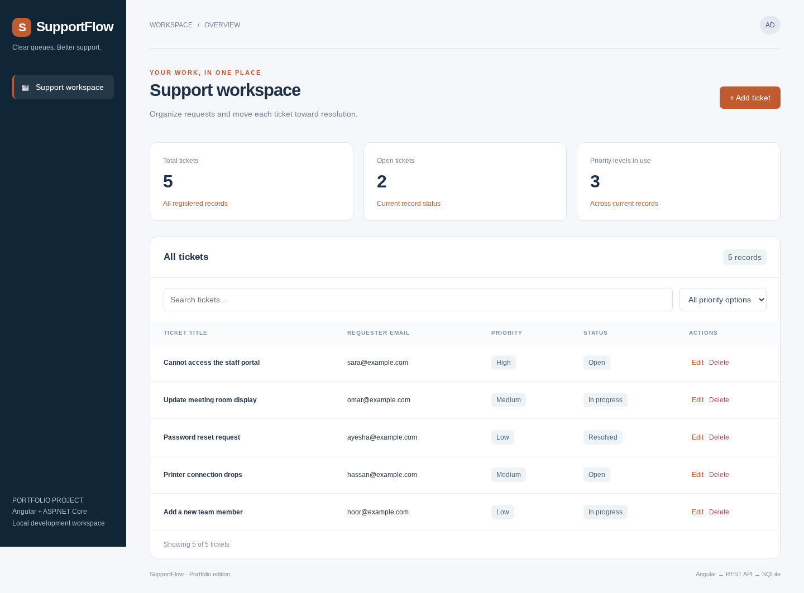

# SupportFlow

A support ticket tracker with an Angular frontend and ASP.NET Core backend, including ticket CRUD, priority filters, status updates, and EF Core SQLite persistence.



## Features
- Create, read, update, and delete tickets.
- Search loaded records and filter by priority.
- Live summary cards, form validation, loading states, and API error feedback.
- C# minimal REST APIs and Entity Framework Core SQLite persistence.
- Demo records seeded on startup when the database is empty.

## Stack
Angular 20 / TypeScript / ASP.NET Core (.NET 10) / EF Core / SQLite.

## Run locally
Install .NET 10 SDK and Node.js 24 LTS with npm. Open two terminals in this repository.

Backend:
```sh
cd backend
dotnet restore
dotnet run --urls http://localhost:5080
```

Frontend:
```sh
cd frontend
npm ci
npm start
```
Open http://localhost:4200. The Angular development proxy forwards `/api` to `http://localhost:5080`. Run one portfolio project at a time because they share these ports.

## API endpoints
| Method | URL | Purpose |
| --- | --- | --- |
| GET | `/api/health` | Health check |
| GET | `/api/tickets` | List records |
| GET | `/api/tickets/{id}` | Read one record |
| POST | `/api/tickets` | Create a record |
| PUT | `/api/tickets/{id}` | Update a record |
| DELETE | `/api/tickets/{id}` | Delete a record |

Example POST/PUT JSON:
```json
{
  "title": "Cannot access the staff portal",
  "requester": "sara@example.com",
  "priority": "High",
  "status": "Open"
}
```
Use `backend/requests.http` with an HTTP client or Visual Studio. Invalid input returns HTTP 400; missing IDs return 404. POST returns 201 and DELETE returns 204.

## Connection flow
`Angular component → ApiService / HttpClient → /api development proxy → C# endpoint → EF Core → app.db`

`frontend/src/app/api.service.ts` owns HTTP requests. `backend/Program.cs` owns endpoint mappings, validation, seeding, and the database model. SQLite is created automatically in the backend working directory. The connection can be overridden with the `ConnectionStrings__Default` environment variable.

## Build
```sh
cd frontend
npm run build
```
```sh
cd backend
dotnet build
```

## Upload to GitHub
Create an empty GitHub repository named `supportflow`, then run from this project folder:
```sh
git init
git add .
git commit -m "Add SupportFlow full-stack starter"
git branch -M main
git remote add origin https://github.com/YOUR_USERNAME/supportflow.git
git push -u origin main
```
GitHub repository description: **A support ticket tracker with an Angular frontend and ASP.NET Core backend, including ticket CRUD, priority filters, status updates, and EF Core SQLite persistence.**
Suggested topics: `angular`, `csharp`, `aspnet-core`, `rest-api`, `entity-framework-core`, `sqlite`, `portfolio`.

## Scope and next steps
This is an educational CRUD starter, with no authentication, roles, pagination, audit trail, or production deployment configuration. It uses `EnsureCreated` for a simple local database; adopt EF migrations before evolving a deployed schema. All seed records are fictional. Add unique email/SKU rules if required by your use case. Search/filter operate on the records already loaded in the browser.

For a stronger portfolio, add tests, authentication, and domain features, and describe your own contributions in this README.

## Verification
Both Angular and C# builds passed. Browser checks against the real C# backend covered initial loading, search, filtering, create, edit, delete, and reload. API checks covered invalid input (400) and missing records (404). Desktop and mobile screenshots are in `docs/`. Screenshots use the seeded demo data.
